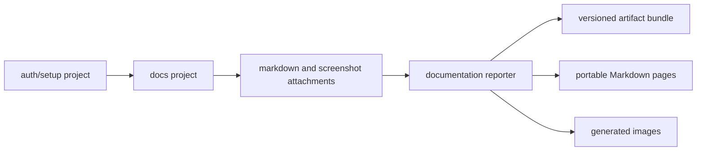

# Architecture

Docs Tests is a small Playwright-based documentation generation system.

## System Shape

The project has four parts:

- Playwright config and projects
- optional authentication setup
- documentation specs
- a custom reporter that normalizes attachments into an artifact bundle and
  renders portable Markdown pages

## Playwright Projects

`playwright.config.ts` defines:

- `auth-setup`: creates `.auth/docs-user.json`
- `docs`: runs `tests/docs/**/*.doc.ts` with that storage state

The setup project writes an empty storage state when no credentials are
configured. That keeps public or unauthenticated apps simple while preserving
the same shape for apps that need login.

## Documentation Contract

Documentation specs attach data through Playwright's `testInfo.attach`. New
helpers use namespaced, versioned attachment envelopes:

- `docs-tests:guide`: stable guide metadata (`id`, `slug`, `title`, optional
  ordering, tags, permissions, and JSON metadata)
- `docs-tests:markdown`: prose inserted into the generated guide
- `docs-tests:permissions`: structured permission notes
- `docs-tests:image:<uuid>` and `docs-tests:image-metadata`: image bytes and
  metadata linked by attachment name

The legacy `markdown`, `permissions`, `image`, and `image-caption` names remain
supported for existing guides. The reporter ignores unrelated Playwright
attachments, so traces, videos, and report artifacts can coexist with generated
documentation.

The reporter validates all image MIME types against a fixed allowlist and never
uses attachment names or MIME suffixes as filesystem paths.

## Output Model

Generated output defaults to:

- `generated-docs/<guide-slug>/page.md`
- `generated-docs/<guide-slug>/*.png`
- `generated-docs/docs-tests.bundle.json`
- `generated-docs/.docs-tests-manifest.json`

Environment overrides:

- `DOCS_OUT_DIR`: where Markdown pages are written
- `DOCS_IMG_OUT_DIR`: where image files are written
- `DOCS_IMAGE_PUBLIC_PATH`: public URL prefix for image references in Markdown

If `DOCS_IMAGE_PUBLIC_PATH` is omitted, generated Markdown references images
beside the page with `./image-name.png`.

The reporter first writes to a temporary staging directory. It publishes output
only after a complete, unfiltered Playwright run passes; direct filtered or
sharded runs must be merged before publication. The artifact bundle preserves guide
identity, normalized source references, asset integrity hashes, and redaction
reasons. The default Markdown renderer only emits portable Markdown; it does
not generate Liquid, MDX, or site-specific directives.

Existing files are preserved by default. `clean: 'manifest-owned'` with
`fullRun: true` removes only files named in the matching previous manifest and
only when their content still matches its recorded hash. The publisher rejects
path traversal, output-root symlinks, overlapping output roots, unowned file
collisions, and root changes during cleanup. Individual files are published
with temporary-file-plus-rename; two arbitrary output roots are not a
transactional tree swap.

## Grouping Rules

Explicit `attachGuide(...)` metadata defines the stable public guide identity.
Multiple tests with the same guide metadata become sections in one generated
page. Each contributing test attaches that metadata, commonly from a
`test.beforeEach` hook. When explicit metadata is absent, the reporter groups tests by the
nearest `test.describe(...)` block as a compatibility fallback.

An explicit slug cannot also be claimed by a separate legacy-inferred guide.
Migrate both guides to explicit metadata or choose distinct slugs; this keeps
parallel result ordering from changing the generated output.

This lets one guide contain a few related flows while keeping unrelated guides
in separate folders.

## Screenshots

`takeDocScreenshot(...)` highlights one or more locators, waits for the browser
to settle across two render frames, captures a page screenshot, and then removes
the highlight. Its typed options forward Playwright capture controls such as
`fullPage`, `mask`, `maskColor`, `scale`, `animations`, `caret`, and `style`.
`redactions` both mask locators and retain non-sensitive reasons in the artifact
bundle. The helper owns the attachment name and ignores runtime screenshot
paths.

It retries highlight operations for detached element errors because UI
frameworks can replace nodes during render.

## Extension Points

Common app-specific extensions:

- replace `tests/setup/auth.setup.ts` with app-specific login
- add a database or API fixture that seeds deterministic scenarios
- add accessibility scan attachments
- consume the bundle from a framework-specific docs route outside this package
