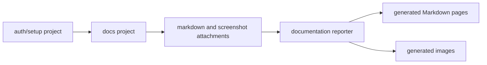

# Architecture

Docs Tests is a small Playwright-based documentation generation system.

## System Shape

The project has four parts:

- Playwright config and projects
- optional authentication setup
- documentation specs
- a custom reporter that converts attachments into Markdown pages

## Playwright Projects

`playwright.config.ts` defines:

- `auth-setup`: creates `.auth/docs-user.json`
- `docs`: runs `tests/docs/**/*.doc.ts` with that storage state

The setup project writes an empty storage state when no credentials are
configured. That keeps public or unauthenticated apps simple while preserving
the same shape for apps that need login.

## Documentation Contract

Documentation specs attach data through Playwright's `testInfo.attach`.

Supported attachment names:

- `markdown`: prose inserted into the generated guide
- `permissions`: newline-separated permissions rendered as a callout
- `image`: PNG screenshot data
- `image-caption`: caption for the preceding image

The custom reporter ignores other attachments so normal Playwright traces,
videos, and report artifacts can coexist with generated docs.

## Output Model

Generated output defaults to:

- `generated-docs/<guide-slug>/page.md`
- `generated-docs/<guide-slug>/*.png`

Environment overrides:

- `DOCS_OUT_DIR`: where Markdown pages are written
- `DOCS_IMG_OUT_DIR`: where image files are written
- `DOCS_IMAGE_PUBLIC_PATH`: public URL prefix for image references in Markdown

If `DOCS_IMAGE_PUBLIC_PATH` is omitted, generated Markdown references images
beside the page with `./image-name.png`.

## Grouping Rules

The reporter groups tests by the nearest `test.describe(...)` block. Multiple
tests in one describe block become sections in one generated page.

This lets one guide contain a few related flows while keeping unrelated guides
in separate folders.

## Screenshots

`takeDocScreenshot(...)` highlights one or more locators, waits for the browser
to settle across two render frames, captures a page screenshot, and then removes
the highlight.

It retries highlight operations for detached element errors because UI
frameworks can replace nodes during render.

## Extension Points

Common app-specific extensions:

- replace `tests/setup/auth.setup.ts` with app-specific login
- add a database or API fixture that seeds deterministic scenarios
- add a docs manifest writer in the reporter
- add accessibility scan attachments
- publish output into a framework-specific docs route
